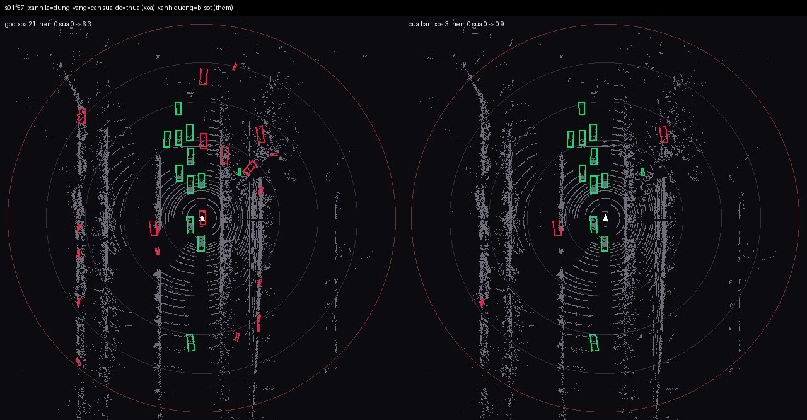

# Báo cáo Day 14 — Nguyen Hai Nam — 2A202603309

> Sao chép file này thành `report/individual/<MSSV>_<HoTen>.md` (không dấu), ví dụ `2A20260000_NguyenVanAn.md`.

- Mã học viên dùng với `--student`: `2A202603309`
- `seed_tag` trong `frames_A.txt`: `82ac3100fd`

## 1. Dự đoán trước sweep (bước 5b)

Ghi **trước** khi chạy `scripts/pp_sweep.py`, rồi commit và push ngay (lịch sử commit là bằng chứng thời điểm viết). Không sửa phần này sau khi có kết quả.

- Tham số tôi nghĩ giảm công sửa nhiều nhất: tăng đồng thời cả `score_thr` và `min_points`.
- Vì sao (nhìn ảnh BEV tập A: box thừa nhiều hay box sót nhiều?):
  - Trên tập A, mô hình chủ yếu vẽ **thừa** hộp hơn là bỏ sót: tôi phải xóa 35 hộp nhưng chỉ thêm 4 hộp (85 hộp dự đoán so với 54 hộp trong nhãn tham chiếu).
  - `score_thr`: chỉ giữ các hộp mà mô hình đủ tự tin là một vật thể thật, nhờ đó loại bớt các dự đoán không chắc chắn.
  - `min_points`: khi sửa trên CVAT, tôi nhiều lần phải xóa các hộp chứa quá ít điểm LiDAR, đến mức nhìn bằng mắt cũng không xác định được đó là vật gì. Nhiều hộp người (Pedestrian/Cyclist) bị vẽ sai rơi vào trường hợp này. Lọc theo số điểm sẽ loại được nhóm hộp này.

## 2. Tập A: sửa tay và tune

| Cấu hình | Xóa | Thêm | Sửa | Chi phí |
|---|---:|---:|---:|---:|
| Gốc | 35 | 4 | 0 | 14.5 |
| `best_config.json` | 11 | 8 | 0 | 11.3 |

- Tham số đã đổi trong `best_config.json`: `score_thr` 0.1 → 0.5; `min_points` giữ 0 (các mức 0/5/10 cho chi phí như nhau ở mọi `score_thr`).
- Kết quả sweep (15 cấu hình × 3 frame), chi phí theo `score_thr` (không đổi theo `min_points`):

  | `score_thr` | 0.1 | 0.2 | 0.3 | 0.4 | 0.5 |
  |---|---:|---:|---:|---:|---:|
  | Chi phí | 14.5 | 14.5 | 12.4 | 13.0 | 11.3 |

- Kết quả leave-one-out (dán các dòng `scripts/pp_sweep.py` in ra):

  ```
  s01f57: cấu hình chọn {'score_thr': '0.3', 'min_points': '0'} → 4.2 (tốt nhất có thể 0.9)
  s04f21: cấu hình chọn {'score_thr': '0.5', 'min_points': '0'} → 5.2 (tốt nhất có thể 5.2)
  s05f31: cấu hình chọn {'score_thr': '0.5', 'min_points': '0'} → 5.2 (tốt nhất có thể 3.0)
  ```

- Cấu hình có ổn định trên từng frame không? Không ổn định. Khi bỏ s01f57 ra, cấu hình được chọn đổi sang `score_thr=0.3`. Theo từng frame: s01f57 giảm mạnh (6.3 → 0.9), s04f21 không đổi (5.2), còn s05f31 tăng (3.0 → 5.2) vì ngưỡng 0.5 làm mất các hộp đúng có score thấp, phải thêm lại. Vì sao tôi vẫn chọn (hoặc không chọn) nó: <!-- TODO (tự viết): lý do bạn chọn/không chọn score_thr=0.5 -->

## 3. Trước/sau (bước 8)



- `scripts/pp_compare.py` báo giảm 22% công sửa trên tập A (14.5 → 11.3; xóa 35 → 11, thêm 4 → 8, sửa 0 → 0), chỉ tính trên 3 frame.
- Dự đoán ở mục 1 đúng hay sai? Giải thích bằng số box xóa/thêm/sửa: <!-- TODO (tự viết): kết luận đối chiếu với dự đoán ở mục 1 -->

  Dữ kiện để đối chiếu: `score_thr` 0.5 giảm số hộp phải xóa từ 35 xuống 11 nhưng tăng số hộp phải thêm từ 4 lên 8; `min_points` 5 hoặc 10 không làm thay đổi chi phí ở bất kỳ mức `score_thr` nào trên tập A.

## 4. Tập B

Số đo từ `scripts/pp_prelabel.py --frames d14_2A202603309/frames_B.txt --config d14_2A202603309/best_config.json --gt d14_2A202603309/ref_B.json`:

| Xóa | Thêm | Sửa | Chi phí |
|---:|---:|---:|---:|
| | | | |

- Loại box tốn công sửa nhất ở tập B: ...

## 5. Giới hạn

- **Chỉ 3 frame để tune:** leave-one-out cho thấy cấu hình tốt nhất thay đổi khi bỏ một frame, và `score_thr=0.5` làm tăng chi phí ở s05f31. Mức giảm 22% trên tập A không đảm bảo lặp lại trên dữ liệu khác.
- **Mô hình học trên KITTI:** LiDAR 64 tia, chỉ gán nhãn phía trước và chỉ có 3 lớp (Car, Cyclist, Pedestrian). Mô hình không biết Truck/Bus (chỉ đổi lớp theo luật kích thước) và hay bỏ sót hoặc vẽ nhầm Pedestrian/Cyclist trên dữ liệu VF.
- **Chi phí là công thức quy ước** (`0.3·xóa + 1.0·thêm + 0.5·sửa`, chỉ trong 50 m), chưa phải thời gian sửa thực tế, nên không quy đổi được ra số giờ công tiết kiệm.
- **Nhãn tham chiếu do một người sửa:** `ref_A`/`ref_B` phản ánh đánh giá của riêng tôi, chưa được người thứ hai kiểm chéo.
